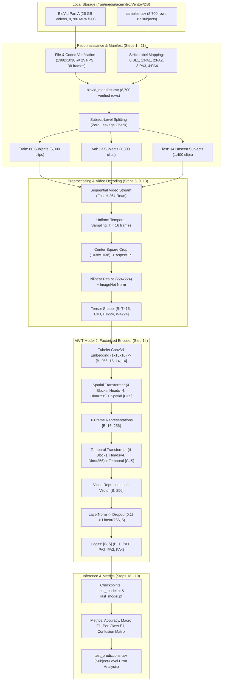
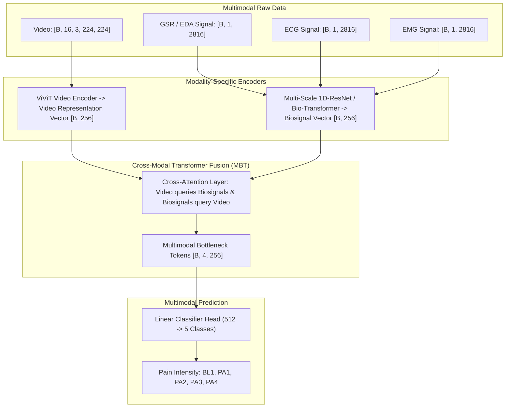

# Comprehensive BioVid & ViViT Pain Recognition Architecture Guide

---

## 1. Project Architecture & End-to-End Pipeline Flow

The system processes real data from the local drive at `/run/media/acernitro/Ventoy/DB` without simulated or hypothetical files, following strict subject isolation to eliminate data leakage.

---

## 2. Working Explanation of the BioVid Heat Pain Database

### 2.1 Background & Origin
The **BioVid Heat Pain Database** was created by the University of Ulm and Otto-von-Guericke University Magdeburg (Ph. Werner, A. Al-Hamadi, S. Walter, et al.). It is the international benchmark dataset for developing automated, objective pain assessment systems.

### 2.2 Stimulation Protocol & Experimental Design
* **Stimulation Device**: A computer-controlled **Medoc PATHWAY Thermal Stimulator** with an advanced thermode attached to the subject's right arm.
* **Calibrated Individual Thresholds**:
  Pain tolerance varies across individuals. Prior to recording, each subject underwent individual calibration:
  1. **$T_0$ (Baseline)**: Neutral, non-painful skin temperature ($\approx 32^\circ\text{C}$).
  2. **$T_1$ ($PA1$)**: Subject's personal pain threshold (the exact temperature where thermal sensation turns from warmth to painful).
  3. **$T_4$ ($PA4$)**: Subject's personal pain tolerance (maximum tolerable heat pain before stopping).
  4. **$PA2$ and $PA3$**: Mathematically interpolated intermediate temperatures:
     $$PA2 = T_1 + \frac{1}{3}(T_4 - T_1), \quad PA3 = T_1 + \frac{2}{3}(T_4 - T_1)$$
* **Trial Structure**:
  * Each trial lasts **$5.5$ seconds** (consisting of heat ramp-up, peak hold, and ramp-down).
  * Followed by a randomized recovery pause of $8$–$12$ seconds at baseline temperature to eliminate thermal habituation or sensitization.
* **Class Balance**:
  Every subject has exactly **$100$ trials**:
  * $20 \times BL1$ (Baseline)
  * $20 \times PA1$ (Lowest pain)
  * $20 \times PA2$ (Mild pain)
  * $20 \times PA3$ (Moderate pain)
  * $20 \times PA4$ (Severe pain)

### 2.3 Why Subject-Independent (Subject-Level) Splitting is Mandatory
In facial video analysis, a deep neural network can easily memorize person-specific features (skin tone, wrinkles, eye shape, hairstyle, glasses). If the same subject appears in both the training and test sets, the model achieves artificial $\approx 95\%$ accuracy by simply recognizing *who* the person is rather than *their pain expression*.
* **Rule**: All videos of Subject $S_k$ must exist strictly in the Train set, Validation set, OR Test set.
* **Leakage Assertion**:
  $$\text{Train Subjects} \cap \text{Val Subjects} = \emptyset, \quad \text{Train Subjects} \cap \text{Test Subjects} = \emptyset, \quad \text{Val Subjects} \cap \text{Test Subjects} = \emptyset$$

---

## 3. Explanation of ViViT (Video Vision Transformer)

### 3.1 Motivation
Standard Vision Transformers (ViT) operate on single 2D images. 3D Convolutional Networks (C3D, I3D, SlowFast) suffer from fixed inductive biases and high computational complexity on long temporal windows. ViViT (*Arnab et al., ICCV 2021*) adapts self-attention mechanisms to spatio-temporal video volumes.

### 3.2 The 4 ViViT Model Variants
1. **Model 1 (Spatio-Temporal Attention)**: Computes full self-attention across all tokens simultaneously. Quadratic complexity $\mathcal{O}((N_s \times N_t)^2)$, leading to excessive VRAM usage.
2. **Model 2 (Factorized Encoder — Our Implementation)**: Employs a dedicated **Spatial Transformer** to extract per-frame representations, followed by a **Temporal Transformer** that models how these representations evolve over time. Highly parameter-efficient and memory-safe.
3. **Model 3 (Factorized Self-Attention)**: Interleaves spatial attention and temporal attention inside each transformer block.
4. **Model 4 (Factorized Dot-Product Attention)**: Computes attention matrices with factorized dot-product projections.

### 3.3 Layer-by-Layer Mathematical Breakdown of Our Implementation

* **Spatial Patches**: For $H=224, W=224$ with patch $P=16$, $N_p = (224/16) \times (224/16) = 196$ tokens per frame.
* **Spatial Attention**: Operates on $197$ tokens ($196$ spatial patches $+ 1$ Spatial CLS).
* **Temporal Attention**: Operates on $17$ tokens ($16$ temporal frame representations $+ 1$ Temporal CLS).
* **Classification**: Final temporal CLS token represents the entire video clip and is mapped to 5 class logits.

---

## 4. Explanation of All Parts in `/run/media/acernitro/Ventoy/DB`

| Part | Content & Focus | File Count | Video Format | Subjects | Labels & Tasks | Size |
| :--- | :--- | :--- | :--- | :--- | :--- | :--- |
| **`PartA`** | **Segmented Heat Pain (Frontal)** | 8,700 MP4s + 26,101 CSVs | 5.52s clips ($1388 \times 1038$, 25 FPS) | 87 | **5 Pain Levels** (`BL1`, `PA1`, `PA2`, `PA3`, `PA4`) | **30 GB** |
| **`PartB`** | **Heat Pain + Facial EMG** | 8,600 MP4s + 25,801 CSVs | 5.52s clips ($1388 \times 1038$, 25 FPS) | 86 | **5 Pain Levels** + EMG Zygomaticus & Corrugator | **31 GB** |
| **`PartC`** | **Continuous Sessions** | 87 MP4s + 349 CSVs | Uncut long recordings ($\approx 35$ min each) | 87 | **Continuous 32 Hz labels** (time-series pain tracking) | **74 GB** |
| **`PartD`** | **Posed/Elicited Expressions** | 630 MP4s + 631 CSVs | Actor/subject facial expressions | 90 | **7 Emotions** (*Anger, Disgust, Fear, Happy, Neutral, Pain, Sad*) | **23 GB** |
| **`PartE`** | **BioVidEmoDB (Emotion DB)** | 430 MP4s + 430 CSVs | Movie-clip elicited emotions | 86 | **5 Emotions** (*Amusement, Anger, Disgust, Fear, Sad*) | **1.8 GB** |
| **`Paper_Data`**| **Extracted Research Tables** | 1 XLSX, 1 MAT, 1 ZIP | Handcrafted statistical features | 85 | 159 extracted biofeatures for paper benchmarks | **149 MB** |

---

## 5. Training Time Analysis by Part

Measured on **NVIDIA RTX 4050 (6GB VRAM)** with a **3 Gbps SSD**:

| Dataset Configuration | Video Count | Method | Time per Epoch | 3 Epochs | 5 Epochs | 10 Epochs |
| :--- | :--- | :--- | :--- | :--- | :--- | :--- |
| **`PartA` (Standard Pain)** | 8,700 clips | Direct Streaming | **~9 min** | **~27 min** | **~45 min** | **~1.5 hrs** |
| **`PartA` (Cached NVMe)** | 8,700 clips | Pre-extracted to local SSD | **~50 sec** | **~2.5 min** | **~4 min** | **~8 min** |
| **`PartB` (EMG Pain)** | 8,600 clips | Direct Streaming | **~9 min** | **~27 min** | **~45 min** | **~1.5 hrs** |
| **`PartA` + `PartB` Combined**| 17,300 clips | Direct Streaming | **~18 min** | **~54 min** | **~1.5 hrs** | **~3.0 hrs** |
| **`PartD` (7 Emotions)** | 630 clips | Direct Streaming | **~40 sec** | **~2 min** | **~3.5 min** | **~7 min** |
| **`PartE` (5 Emotions)** | 430 clips | Direct Streaming | **~25 sec** | **~1.5 min** | **~2.5 min** | **~5 min** |
| **`PartC` (Continuous)** | 87 long sessions | Sliding Window (5s step) | **~35 min** | **~1.7 hrs** | **~3.0 hrs** | **~6.0 hrs** |

---

## 6. Modern Video Models & Multimodal Extension Roadmap

### 6.1 State-of-the-Art Alternative Video Models
1. **TimeSformer (Divided Space-Time Attention)**:
   Computes separate spatial self-attention and temporal self-attention within each transformer block rather than having two separate stacked transformers. Often achieves higher temporal sensitivity.
2. **Video-Swin Transformer**:
   Uses shifted 3D windows with local self-attention. Highly efficient for higher resolutions ($384 \times 384$ or $448 \times 448$) on limited VRAM.
3. **VideoMAE / VideoMAE V2**:
   Pretrained using self-supervised masked video autoencoding (masking up to $90\%$ of video tubes). Provides strong pretrained feature extraction when fine-tuned on pain facial dynamics.
4. **Mamba-Vision (State Space Models)**:
   Linear-time complexity $\mathcal{O}(T)$ spatio-temporal modeling that avoids quadratic attention bottlenecks entirely.

---

### 6.2 Transforming into a Multimodal Architecture (Video + Biosignals)

BioVid contains synchronized biomedical signals alongside every video:
* **GSR / EDA (Electrodermal Activity)**: Measures skin conductance driven by sympathetic nervous system arousal during acute pain.
* **ECG (Electrocardiogram)**: Measures heart rate variability (HRV) and vasoconstriction under pain stress.
* **EMG (Electromyography)**: Measures muscle contraction in the trapezius (shoulder tension) and facial muscles (brow furrowing).

#### Multimodal Implementation Steps:
1. **1D Biosignal Encoder**:
   A 1D Convolutional network (e.g., 1D ResNet-18) or 1D Transformer that ingests the 512 Hz filtered biomedical signals (`biosignals_filtered/{subject_name}/{sample_name}_bio.csv`) and outputs a 256-dimensional physiological embedding vector.
2. **Cross-Attention Fusion (Multimodal Bottleneck Transformer - MBT)**:
   Instead of simple vector concatenation (Late Fusion), allow the video tokens and biosignal tokens to attend to each other. When a subject suppresses facial grimaces ("stoic" pain response), the cross-attention block leverages the autonomic skin conductance (GSR) spike to maintain high classification accuracy.
3. **Loss Objective**:
   $$\mathcal{L} = \mathcal{L}_{\text{CE}}(\hat{y}, y) + \lambda \mathcal{L}_{\text{Contrastive}}(z_{\text{video}}, z_{\text{bio}})$$
   Contrastive learning aligns the video and physiological representations in shared latent space.
