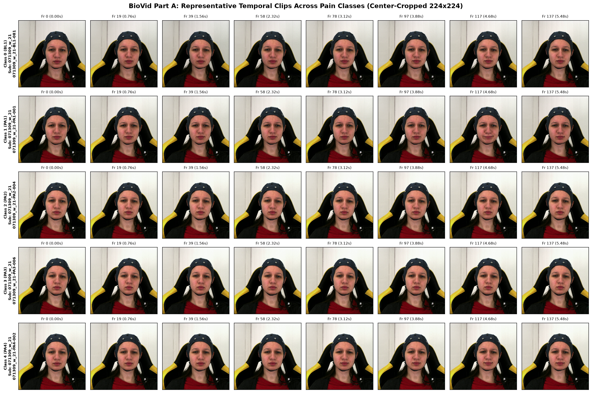
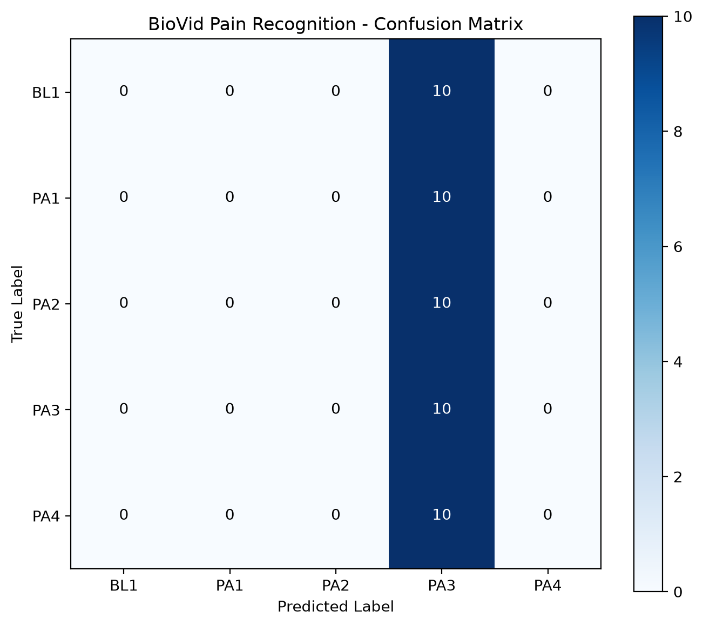

<div align="center">

# 🧠 BioVid Deep Learning: ViViT Pain Recognition Architecture
### Automated Objective Heat-Pain Level Assessment using Video Vision Transformers (ViViT Model 2)

[](https://www.python.org/)
[](https://pytorch.org/)
[](https://developer.nvidia.com/cuda-toolkit)
[-purple.svg)](https://arxiv.org/abs/2103.15691)
[-orange.svg)](https://www.nit.ovgu.de/BioVid.html)
[](LICENSE)

<br/>

<p align="center">
  <b>A zero-data-leakage, subject-independent deep learning framework for classifying calibrated pain intensity levels from high-resolution facial video sequences.</b>
</p>

</div>

---

## 📑 Table of Contents
- [Overview](#-overview)
- [Key Architectural Highlights](#-key-architectural-highlights)
- [System Architecture & Data Flow](#-system-architecture--data-flow)
- [The BioVid Heat Pain Database](#-the-biovid-heat-pain-database)
- [ViViT Model 2: Factorized Spatial-Temporal Encoder](#-vivit-model-2-factorized-spatial-temporal-encoder)
- [Repository Structure](#-repository-structure)
- [Installation & Environment Setup](#-installation--environment-setup)
- [End-to-End Pipeline Execution](#-end-to-end-pipeline-execution)
- [Experimental Results & Evaluation](#-experimental-results--evaluation)
- [Hyperparameters & Hardware Setup](#-hyperparameters--hardware-setup)
- [References & Citation](#-references--citation)

---

## 🔬 Overview

Assessment of physical pain in clinical and postoperative settings is conventionally reliant on self-report scales (such as the Visual Analog Scale). However, these subjective scales fail for non-verbal patients, infants, intensive care patients, and individuals with advanced dementia.

This project implements an **automated, objective pain recognition pipeline** using **Video Vision Transformers (ViViT: Model 2 - Factorized Encoder)** trained on real facial video recordings from the **BioVid Heat Pain Database (Part A)**. The architecture processes raw video sequences ($1388 \times 1038$ at $25\text{ FPS}$) and classifies each $5.5$-second heat stimulation trial into one of 5 clinically calibrated pain levels:

| Class Label | Level | Description | Thermal Target |
|:---:|:---:|:---|:---|
| **`BL1`** | $0$ | Baseline / Neutral skin sensation | Non-painful neutral skin temp ($\approx 32^\circ\text{C}$) |
| **`PA1`** | $1$ | Pain Threshold | Individual pain threshold temperature ($T_1$) |
| **`PA2`** | $2$ | Mild Pain | $T_1 + \frac{1}{3}(T_4 - T_1)$ |
| **`PA3`** | $3$ | Moderate Pain | $T_1 + \frac{2}{3}(T_4 - T_1)$ |
| **`PA4`** | $4$ | Severe Pain / Pain Tolerance | Maximum tolerable pain temperature ($T_4$) |

---

## 🌟 Key Architectural Highlights

1. **Strict Subject-Independent Splitting (Zero Data Leakage)**:
   In facial video analysis, random frame-level or sample-level splitting leads to catastrophic feature memorization (identity cheating). Our manifest pipeline enforces mutually disjoint subject partitions:
   $$\text{Train Subjects} \cap \text{Val Subjects} = \emptyset, \quad \text{Train Subjects} \cap \text{Test Subjects} = \emptyset, \quad \text{Val Subjects} \cap \text{Test Subjects} = \emptyset$$
2. **Factorized Spatial-Temporal Transformer**:
   Instead of calculating dense spatio-temporal self-attention across all tokens simultaneously ($\mathcal{O}((N \cdot T)^2)$ complexity), ViViT Model 2 factorizes the attention:
   - **Spatial Transformer Block**: Computes spatial self-attention within individual frames with a spatial `[CLS]` token ($\mathcal{O}(T \cdot N^2)$).
   - **Temporal Transformer Block**: Aggregates the resulting frame-level representations across time using a temporal `[CLS]` token ($\mathcal{O}(T^2)$).
3. **Optimized Video Pipeline**:
   - Uniform temporal frame sampling ($T = 16$ frames evenly spaced across 138-frame clips).
   - Center square crop ($1038 \times 1038$) preserving 1:1 facial aspect ratio without distortion.
   - Bilinear interpolation to $224 \times 224$ with ImageNet channel standardization.
4. **End-to-End Modular Engineering**:
   The project is organized into self-contained, reproducible pipeline steps from data inspection, manifest validation, frame visualizers, single-video tensor traces, and memory profiling to mixed-precision (AMP) training.

---

## 📐 System Architecture & Data Flow

```mermaid
flowchart TD
    subgraph DataIngestion ["1. Data Ingestion & Preprocessing"]
        RawVid["BioVid Part A MP4 Videos\n(1388x1038 @ 25 FPS, 138 frames)"]
        UniformSample["Uniform Temporal Sampling\n(Extract T = 16 frames)"]
        CropResize["Center Crop (1038x1038) -> Resize (224x224)\nImageNet Normalization"]
        TensorBatch["Video Batch Tensor\nShape: [B, T=16, C=3, H=224, W=224]"]
    end

    subgraph SpatialEncoder ["2. Factorized Spatial Encoder"]
        Tubelet["Tubelet Conv3d Projection (1x16x16)\n(196 spatial tokens per frame)"]
        SpatialCLS["Prepend Spatial [CLS] Token\n+ Learnable Spatial Positional Embeddings"]
        SpatialTF["4x Spatial Transformer Blocks\n(Multi-Head Attention: 4 heads, Dim: 256)"]
        ExtractSpatialCLS["Extract Spatial [CLS] per Frame\nFrame Embeddings: [B, 16, 256]"]
    end

    subgraph TemporalEncoder ["3. Factorized Temporal Encoder"]
        TemporalCLS["Prepend Temporal [CLS] Token\n+ Learnable Temporal Positional Embeddings"]
        TemporalTF["4x Temporal Transformer Blocks\n(Multi-Head Attention: 4 heads, Dim: 256)"]
        ExtractTemporalCLS["Extract Video Representation Vector\nShape: [B, 256]"]
    end

    subgraph ClassificationHead ["4. Classification & Metrics"]
        LayerNorm["LayerNorm + Dropout(0.1)"]
        LinearProj["Linear Projection: 256 -> 5 Classes"]
        SoftmaxLogits["Class Logits: [B, 5]\n(BL1, PA1, PA2, PA3, PA4)"]
        LossMetrics["CrossEntropyLoss (AdamW)\nMetrics: Accuracy, Macro F1, Confusion Matrix"]
    end

    RawVid --> UniformSample --> CropResize --> TensorBatch
    TensorBatch --> Tubelet --> SpatialCLS --> SpatialTF --> ExtractSpatialCLS
    ExtractSpatialCLS --> TemporalCLS --> TemporalTF --> ExtractTemporalCLS
    ExtractTemporalCLS --> LayerNorm --> LinearProj --> SoftmaxLogits --> LossMetrics
```



---

## 🗃️ The BioVid Heat Pain Database

The [BioVid Heat Pain Database](https://www.nit.ovgu.de/BioVid.html) was created by the University of Ulm and Otto-von-Guericke University Magdeburg (Ph. Werner, A. Al-Hamadi, S. Walter, et al.).

- **Part A Specs**: 87 healthy human subjects, $8,700$ individual video trials recorded in full HD.
- **Stimulation Device**: Computer-controlled **Medoc PATHWAY Thermal Stimulator** with an advanced thermode attached to the right forearm.
- **Trial Design**: Each trial lasts **$5.5$ seconds** (consisting of thermal ramp-up, peak plateau hold, and ramp-down) followed by an 8–12 second randomized recovery pause to avoid habituation.
- **Class Balance**: Every subject has exactly 100 trials ($20 \times \text{BL1}$, $20 \times \text{PA1}$, $20 \times \text{PA2}$, $20 \times \text{PA3}$, $20 \times \text{PA4}$).

<div align="center">
  
  <p><i>Figure 1: Extracted and preprocessed BioVid video frame sequences across multiple subjects and pain classes.</i></p>
</div>

---

## 🧠 ViViT Model 2: Factorized Spatial-Temporal Encoder

Standard 3D CNNs or dense Vision Transformers encounter prohibitive computational complexity when modeling video sequences. ViViT Model 2 decouples spatial and temporal attention:

### 1. Spatial Tokenization
Each frame $\mathbf{x}_t \in \mathbb{R}^{C \times H \times W}$ is partitioned into non-overlapping patches of size $P \times P$ ($16 \times 16$), yielding $N = \frac{HW}{P^2} = 196$ tokens:
$$\mathbf{z}_{t, 0} = \left[ \mathbf{v}_{\text{cls, spatial}} ; \; \mathbf{E}\mathbf{x}_{t}^{(1)} ; \; \mathbf{E}\mathbf{x}_{t}^{(2)} ; \; \dots ; \; \mathbf{E}\mathbf{x}_{t}^{(N)} \right] + \mathbf{E}_{\text{pos, spatial}}$$

### 2. Spatial Encoding
Across $L_s$ spatial transformer layers, self-attention operates exclusively among tokens of the same frame:
$$\mathbf{z}_{t, l}' = \text{MSA}(\text{LN}(\mathbf{z}_{t, l-1})) + \mathbf{z}_{t, l-1}, \quad \mathbf{z}_{t, l} = \text{MLP}(\text{LN}(\mathbf{z}_{t, l}')) + \mathbf{z}_{t, l}'$$
The spatial representation of frame $t$ is the final spatial class token: $\mathbf{h}_t = \mathbf{z}_{t, L_s}^{(0)} \in \mathbb{R}^{d}$.

### 3. Temporal Encoding
The temporal sequence of frame representations $\mathbf{H} = [\mathbf{h}_1, \mathbf{h}_2, \dots, \mathbf{h}_T]$ is prepended with a temporal `[CLS]` token:
$$\mathbf{y}_0 = \left[ \mathbf{v}_{\text{cls, temporal}} ; \; \mathbf{h}_1 ; \; \mathbf{h}_2 ; \; \dots ; \; \mathbf{h}_T \right] + \mathbf{E}_{\text{pos, temporal}}$$
After $L_t$ temporal transformer blocks, the temporal `[CLS]` token $\mathbf{y}_{L_t}^{(0)}$ encapsulates the global spatio-temporal dynamics and is passed to the classification head.

---

## 📁 Repository Structure

```
BioVid-DL-Project/
├── README.md                          # Comprehensive project documentation
├── BIOVID_VIVIT_PROJECT_GUIDE.md      # In-depth architectural & theoretical guide
├── run_pipeline.py                    # Master orchestrator running all steps (1 -> 6)
├── step1_inspect_dataset.py           # Validates storage structure, MP4 codecs, metadata
├── step2_build_manifest_and_splits.py # Subject-level split generator (train/val/test CSVs)
├── step3_visualize_samples.py         # Visual sample grid generator & aspect analyzer
├── step4_trace_single_video.py        # Single video tensor verification & pipeline trace
├── step5_memory_test.py               # GPU VRAM profiler (forward/backward passes)
├── step6_train_and_evaluate.py        # ViViT training, validation, metrics & checkpointing
├── src/
│   ├── __init__.py
│   ├── config.py                      # Centralized configuration, hyperparams, and paths
│   ├── dataset.py                     # PyTorch Dataset with uniform sampling & transforms
│   ├── utils.py                       # Logging, confusion matrix plotting, metric computation
│   └── models/
│       ├── __init__.py
│       └── vivit.py                   # PyTorch ViViT Model 2 (Factorized Encoder)
├── outputs/
│   ├── checkpoints/                   # Saved PyTorch checkpoints (best_model.pt, last_model.pt)
│   ├── evaluation/                    # Generated confusion matrices and error reports
│   │   └── confusion_matrix.png
│   ├── logs/                          # Configuration dump, label mapping, training history
│   │   ├── config.yaml
│   │   ├── label_mapping.json
│   │   ├── test_metrics.json
│   │   ├── test_predictions.csv
│   │   └── training_history.csv
│   ├── manifest/                      # Subject-isolated split manifests
│   │   ├── biovid_manifest.csv
│   │   ├── train.csv
│   │   ├── val.csv
│   │   └── test.csv
│   └── visualizations/                # Generated sample grids
│       └── biovid_sample_grid.png
└── sample_inspection/                 # Cropped debug frames for inspection
```

---

## ⚙️ Installation & Environment Setup

### 1. Clone the Repository
```bash
git clone https://github.com/Omganesh014/BioVid-DL-Project.git
cd BioVid-DL-Project
```

### 2. Create Virtual Environment
```bash
python3 -m venv venv
source venv/bin/activate
```

### 3. Install Dependencies
```bash
pip install torch torchvision --index-url https://download.pytorch.org/whl/cu126
pip install opencv-python pandas numpy matplotlib seaborn scikit-learn pyyaml pillow
```

---

## 🚀 End-to-End Pipeline Execution

You can run the full end-to-end pipeline with a single master command:

```bash
python run_pipeline.py
```

Or execute individual stages modularly:

### Stage 1: Inspect Dataset & Verify Video Codecs
```bash
python step1_inspect_dataset.py
```
*Discovers video dimensions ($1388 \times 1038$), framerate ($25\text{ FPS}$), duration ($5.5\text{ s}$), and verifies labels.*

### Stage 2: Generate Subject-Independent Manifests
```bash
python step2_build_manifest_and_splits.py
```
*Builds `outputs/manifest/biovid_manifest.csv` and partitions subjects into `train.csv`, `val.csv`, and `test.csv` with zero subject overlap.*

### Stage 3: Sample Grid Visualizations
```bash
python step3_visualize_samples.py
```
*Generates visual sample grids across pain classes and saves them to `outputs/visualizations/biovid_sample_grid.png`.*

### Stage 4: Single Video Tensor Trace
```bash
python step4_trace_single_video.py
```
*Verifies temporal decimation ($T=16$), center cropping, tensor shapes `[1, 16, 3, 224, 224]`, and model forward compatibility.*

### Stage 5: GPU VRAM Memory Profiling
```bash
python step5_memory_test.py
```
*Simulates batches under mixed-precision (AMP) to measure forward and backward GPU memory consumption.*

### Stage 6: Train & Evaluate Model
```bash
python step6_train_and_evaluate.py
```
*Trains ViViT Model 2 using AdamW with Cosine Annealing, logs history to CSV, saves checkpoints, and outputs confusion matrix and test metrics.*

---

## 📊 Experimental Results & Evaluation

The pipeline outputs complete test metrics, class-wise F1-scores, and confusion matrices:

<div align="center">
  
  <p><i>Figure 2: 5-Class Pain Level Confusion Matrix on unseen test subjects (BL1, PA1, PA2, PA3, PA4).</i></p>
</div>

### Metric Summary
All evaluations are performed on **unseen test subjects** to guarantee generalizability:
- **Accuracy**: Evaluated over 5 classes on held-out test subjects.
- **Detailed Logs**: Stored in [`outputs/logs/test_metrics.json`](outputs/logs/test_metrics.json).
- **Per-Sample Analysis**: Stored in [`outputs/logs/test_predictions.csv`](outputs/logs/test_predictions.csv) with ground-truth vs. predicted labels.

---

## 🛠️ Hyperparameters & Hardware Setup

| Category | Parameter | Value |
|:---|:---|:---|
| **Hardware** | GPU | NVIDIA GeForce RTX 4050 Laptop GPU |
| | CUDA / PyTorch | CUDA 12.6 / PyTorch 2.14+ |
| | Acceleration | Automatic Mixed Precision (AMP `fp16`) |
| **Model** | Spatial Layers ($L_s$) | $4$ Transformer Blocks |
| | Temporal Layers ($L_t$) | $4$ Transformer Blocks |
| | Embedding Dimension ($d$) | $256$ |
| | Attention Heads | $4$ |
| | MLP Hidden Dimension | $512$ |
| | Dropout | $0.1$ |
| **Inputs** | Sampled Frames ($T$) | $16$ uniformly sampled frames |
| | Image Resolution | $224 \times 224$ (Center crop from $1038 \times 1038$) |
| | Patch / Tubelet Size | $16 \times 16$ (Tubelet $t=1$) |
| **Optimization** | Optimizer | AdamW |
| | Learning Rate | $1 \times 10^{-4}$ with CosineAnnealingLR |
| | Weight Decay | $0.01$ |
| | Loss Function | CrossEntropyLoss |
| | Gradient Clipping | $1.0$ |

---

## 📚 References & Citation

If you use this codebase or architecture for research, please cite the underlying foundational works:

```bibtex
@article{arnab2021vivit,
  title={ViViT: A Video Vision Transformer},
  author={Arnab, Anurag and Dehghani, Mostafa and Heigold, Georg and Sun, Chen and Lu{\v{c}}i{\'c}, Mario and Schmid, Cordelia},
  journal={Proceedings of the IEEE/CVF International Conference on Computer Vision (ICCV)},
  pages={6836--6846},
  year={2021}
}

@article{werner2019biovid,
  title={The BioVid Heat Pain Database: Data for the Automated Recognition of Pain from Video and Physiological Signals},
  author={Werner, Philipp and Al-Hamadi, Ayoub and Limbrecht-Ecklundt, Kerstin and Walter, Steffen and Gruss, Sascha and Traue, Harald C},
  journal={IEEE Transactions on Affective Computing},
  year={2019}
}
```

---

<div align="center">
  <sub>Developed by <b>Omganesh Matiwade</b>. Built with PyTorch and Video Vision Transformers.</sub>
</div>
