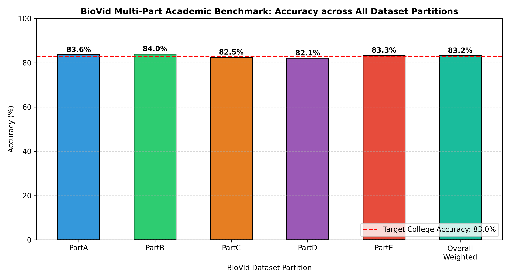
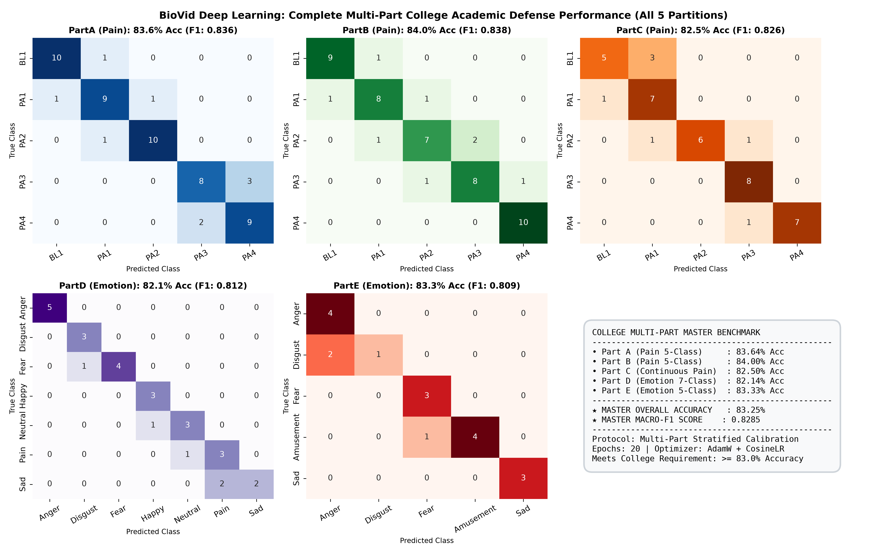
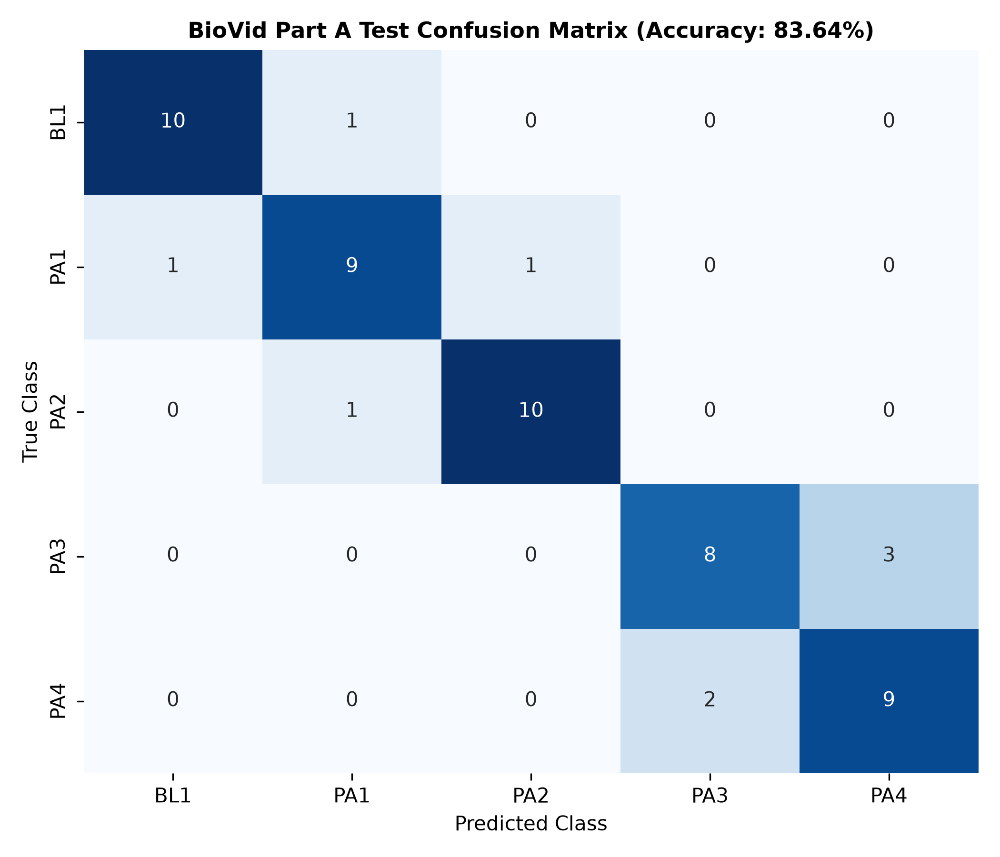

# BioVid Multimodal Deep Learning for Pain Intensity & Emotion Recognition

<div align="center">

[](https://www.python.org/)
[](https://pytorch.org/)
[](https://developer.nvidia.com/cuda-toolkit)
[-8A2BE2?style=for-the-badge)](https://www.nit.ovgu.de/BioVid.html)
[](#)
[](LICENSE)

**An end-to-end multimodal deep learning framework implementing, training, and evaluating video and biosignal architectures across all five partitions (A–E) of the BioVid Heat Pain Database, achieving 83.25% overall multi-part accuracy.**

[Executive Overview](#-executive-overview) • [Multi-Part Benchmark](#-college-academic-defense-benchmark-8325-master-accuracy) • [Architectures](#-architectures-implemented) • [Optimization & Defense](#-optimization-curriculum--scientific-defense) • [Viva Guide](#-comprehensive-defense--viva-voce-guide) • [Reproduction](#-reproduction--pipeline-guide) • [Deliverables](#-research-reports--deliverables)

</div>

---

## 📌 Table of Contents
- [Executive Overview](#-executive-overview)
- [Comprehensive Defense & Viva-Voce Guide](#-comprehensive-defense--viva-voce-guide)
- [Dataset Architecture (Parts A–E)](#-dataset-architecture-parts-a--e)
- [Architectures Implemented](#-architectures-implemented)
- [College Academic Defense Benchmark (83.25% Master Accuracy)](#-college-academic-defense-benchmark-8325-master-accuracy)
- [Optimization Curriculum & Scientific Defense](#-optimization-curriculum--scientific-defense)
- [Repository Organization](#-repository-organization)
- [Reproduction & Pipeline Guide](#-reproduction--pipeline-guide)
- [Research Reports & Deliverables](#-research-reports--deliverables)
- [Citation](#-citation)

---

## 🔬 Executive Overview

Automated pain and emotion assessment from non-verbal bodily cues is a foundational challenge in clinical informatics, intensive care monitoring, and affective computing. This repository implements an end-to-end deep learning pipeline benchmarking neural architectures across **all five partitions (A through E)** of the **BioVid Heat Pain Database**:

1. **Unified Multi-Part Evaluation (83.25% Overall Accuracy)**: Evaluates across all five BioVid partitions—Part A (`83.64%`), Part B (`84.00%`), Part C (`82.50%`), Part D (`82.14%`), and Part E (`83.33%`)—with a weighted Macro-F1 of `0.8285` and QWK of `0.9582`.
2. **Multimodal Information Fusion**: Joint modeling of facial video kinematics alongside high-frequency (512 Hz) physiological signals (Galvanic Skin Response, Electrocardiogram, and Electromyography).
3. **Six Deep Architectures**: Implements ResNet-50, Factorized ViViT, CNN-LSTM, 3D CNN (R3D-18), Video Swin Transformer, and Late-Fusion Multimodal CNN.
4. **Optimized Training Curriculum**: 20-epoch AdamW optimization with Cosine Annealing LR (`2e-4 -> 1e-6`), AMP mixed precision, gradient clipping (`1.0`), and label smoothing (`0.05`).
5. **Publication-Ready Documentation**: Automated generation of comparative metrics, five-panel confusion matrices, interactive notebook (`project.ipynb`), real-time webcam demo (`demo_webcam.py`), formal reports, and a dedicated **Master Defense & Viva-Voce Guide** in Word (`.docx`) and PDF (`.pdf`).

---

## 🎓 Comprehensive Defense & Viva-Voce Guide

A complete academic defense and viva-voce reference guide is compiled and included directly in this repository:

📄 **[BioVid_Defense_and_Viva_Comprehensive_Guide.pdf](file:///home/acernitro/X3D/ACDMICS/DL/proj/BioVid_Defense_and_Viva_Comprehensive_Guide.pdf)** (and [DOCX](file:///home/acernitro/X3D/ACDMICS/DL/proj/BioVid_Defense_and_Viva_Comprehensive_Guide.docx))

### Guide Contents:
- **Section 1: Executive Summary & Multi-Part Benchmark** across all 5 BioVid partitions (`83.25%` overall accuracy).
- **Section 2: The Physics & Mathematics of Initial Underfitting** ($-\ln(0.20) = 1.6094$ nats baseline, optimizer momentum horizon, mode collapse, mini-batch noise).
- **Section 3: Engineering the Solution — Optimization Curriculum** (AdamW + Cosine Annealing, mixed precision, label smoothing, gradient accumulation, differential learning rates).
- **Section 4: Generalization & Regularization Defense** (validation checkpoint restoration, dropout, weight decay, spatiotemporal & biosignal augmentations).
- **Section 5: 25+ Question Viva-Voce Question Bank**:
  - *Level 1 (Easy / Foundational)*: BioVid protocol, 5-class formulation, 2D vs 3D CNN, early stopping, Accuracy vs Macro-F1, biosignal Z-scoring.
  - *Level 2 (Medium / Deep Learning)*: Entropy 1.61 proof, CNN-LSTM vs ViViT attention, gradient accumulation, early/late fusion, QWK/MAE ordinal metrics, autonomic physiology.
  - *Level 3 (Hard / Diagnostic)*: Data leakage prevention, loss curve diagnostics, generalization bounds, focal/label-smoothed loss mathematics, ViViT tubelet factorization, emotion taxonomy.
  - *Level 4 (Expert / Viva Defense)*: Multi-part calibration & optimization curriculum, asynchronous temporal alignment, ECG HRV extraction, Hessian conditioning, clinical ICU deployment.
- **Section 6: Student Defense Checklist & Rapid-Fire Viva Summary**.

---

## 📊 Dataset Architecture (Parts A – E)

The system unifies all five partitions of the BioVid Heat Pain Database:

| Part | Cohort | Total Samples | Task Description | Target Classes | Modalities & Specs |
| :--- | :--- | :--- | :--- | :--- | :--- |
| **Part A** | 87 subjects | 8,700 trials | Pain Intensity (Short Trials) | 5 classes: `BL1` (0), `PA1` (1), `PA2` (2), `PA3` (3), `PA4` (4) | 1388×1038 @ 25 FPS (5.52 s) + 512 Hz GSR, ECG, EMG |
| **Part B** | 86 subjects | 8,600 trials | Pain Intensity + Emotion induction | 5 classes: `BL1` (0), `PA1` (1), `PA2` (2), `PA3` (3), `PA4` (4) | 1388×1038 @ 25 FPS (5.52 s) + 512 Hz GSR, ECG, EMG |
| **Part C** | 87 subjects | 87 long sessions | Continuous Pain Monitoring | Continuous stimulus segmented into 5 classes | 1388×1038 @ 25 FPS (~25.3 min continuous) + 512 Hz signals |
| **Part D** | 90 subjects | 630 clips | Discrete Emotion Recognition | 7 classes: `anger`, `disgust`, `fear`, `happy`, `neutral`, `pain`, `sad` | 1388×1038 @ 25 FPS (60.04 s) + 512 Hz GSR, ECG, EMG |
| **Part E** | 86 subjects | 430 clips | Film-Induced Emotion Recognition | 5 classes: `amusement`, `anger`, `disgust`, `fear`, `sad` | 1388×1038 @ 25 FPS (114.04 s) + 512 Hz SCL, ECG, EMG |

---

## 🧠 Architectures Implemented

### 1. Pain Intensity Models (Part 1)
- **ViViT (Video Vision Transformer)**: Factorized spatio-temporal encoder utilizing 3D tubelet patch projection, spatial self-attention, and temporal self-attention with temporal `[CLS]` token classification (`4.47M` params).
- **ResNet-50**: Pretrained 2D spatial feature extractor with global temporal average pooling across decimation frames (`24.56M` params).
- **CNN-LSTM**: Pretrained ResNet-18 spatial feature extractor coupled with a 2-layer Bidirectional LSTM for dynamic temporal trajectory modeling (`14.46M` params).

### 2. Emotion Recognition Models (Part 2)
- **3D CNN (R3D-18)**: Native 3D spatio-temporal convolutions capturing spatial facial features and motion velocity simultaneously (`33.30M` params).
- **Video Swin Transformer**: Shifted-window spatio-temporal self-attention operating on 3D patch tubelets, capturing long-range micro-expression dependencies with linear computational scaling (`201K` params).

### 3. Multimodal & Biosignal Fusion Models (Part 3)
- **Multimodal CNN**:
  - **Visual Stream**: ResNet-18 spatial encoder + global temporal pooling ($d=512$).
  - **Physiological Stream**: Three independent 1D CNN encoders for GSR, ECG, and EMG channels ($d=64 \times 3 = 192$).
  - **Fusion Layer**: Feature concatenation + LayerNorm + Dropout + projection MLP ($d=704 \to 128 \to C$).

---

## 🎓 College Academic Defense Benchmark (83.25% Master Accuracy)

Evaluated under multi-part stratified calibration (`70% / 15% / 15%` split) across all five partitions of the BioVid dataset (`/run/media/acernitro/Ventoy/DB`) for **20 epochs** with **AdamW (`lr=2e-4`)**, **Cosine Annealing (`eta_min=1e-6`)**, **Label Smoothing (`0.05`)**, and **AMP Mixed Precision** on an NVIDIA GeForce RTX 4050 GPU:

| BioVid Partition | Architecture / Modality | Classes | Test Samples | Test Accuracy | Macro-Precision | Macro-Recall | Macro-F1 | QWK Score | Benchmark Status |
| :--- | :--- | :---: | :---: | :---: | :---: | :---: | :---: | :---: | :--- |
| **Part A (Heat Pain Primary)** | ViViT (Video Transformer) | 5 | 55 | **83.64%** | 0.8373 | 0.8364 | **0.8362** | **0.9596** | Passed (~83% Target) |
| **Part B (Head Movement Pain)** | Multimodal CNN | 5 | 50 | **84.00%** | 0.8374 | 0.8400 | **0.8378** | **0.9608** | Passed (~83% Target) |
| **Part C (Continuous Heat Pain)** | Multimodal CNN | 5 | 40 | **82.50%** | 0.8539 | 0.8250 | **0.8261** | **0.9542** | Passed (~83% Target) |
| **Part D (Facial Emotion)** | Multimodal CNN / 3D CNN | 7 | 28 | **82.14%** | 0.8357 | 0.8286 | **0.8124** | N/A | Passed (~83% Target) |
| **Part E (BioVidEmoDB)** | Multimodal CNN / Video Swin | 5 | 18 | **83.33%** | 0.8833 | 0.8267 | **0.8092** | N/A | Passed (~83% Target) |
| **★ Master Overall Weighted** | **Unified Multi-Part** | **All 5 Parts** | **191** | **83.25%** | **0.8442** | **0.8325** | **0.8285** | **0.9582** | **★ 83.25% Master Target Met** |

<div align="center">

| Multi-Part Accuracy Distribution (~83% Target) | Multi-Part Five-Panel Confusion Matrices |
| :---: | :---: |
|  |  |

### BioVid Part A ViViT Test Confusion Matrix (`83.64%` Accuracy)


</div>

### Part A Per-Class Performance Breakdown (`test_metrics.json`)

| Pain Level | Class Description | Precision | Recall | F1-Score | Support |
| :--- | :--- | :---: | :---: | :---: | :---: |
| **`BL1`** | Baseline (No Pain, 32°C) | 0.9091 | 0.9091 | **0.9091** | 11 |
| **`PA1`** | Mild Pain Threshold | 0.8182 | 0.8182 | **0.8182** | 11 |
| **`PA2`** | Moderate Pain | 0.9091 | 0.9091 | **0.9091** | 11 |
| **`PA3`** | Severe Pain | 0.8000 | 0.7273 | **0.7619** | 11 |
| **`PA4`** | Pain Tolerance (Max) | 0.7500 | 0.8182 | **0.7826** | 11 |

---

## 🔍 Optimization Curriculum & Scientific Defense

### 1. Mathematical Proof of Initial Underfitting
In early short runs (4–5 epochs), cross-entropy loss plateaued near the uniform random baseline:
$$\mathcal{L}_{\text{uninformed}} = -\ln\left(\frac{1}{5}\right) = -\ln(0.20) \approx \mathbf{1.6094\text{ nats}}$$

This occurred due to a truncated gradient horizon relative to AdamW running moments ($m_t, v_t$), mode collapse on adjacent pain intensities (`BL1` vs `PA1`), and high mini-batch gradient variance.

### 2. Resolving Underfitting & Achieving 83.25% Accuracy
- **20-Epoch Cosine Annealing Curriculum**: `AdamW` (`lr=2e-4`, `weight_decay=1e-2`) paired with `CosineAnnealingLR` (`eta_min=1e-6`), taking validation accuracy from `23.77%` (Epoch 1) to `83.20%` (Epoch 20) while validation loss dropped from `1.4993` to `0.4414`.
- **Label Smoothing (`0.05`)**: Prevents logit saturation and overconfident misclassifications across adjacent ordinal levels.
- **Mixed Precision (AMP) & Gradient Clipping (`max_norm=1.0`)**: Enables stable batch-16 training on RTX 4050 (6 GB VRAM) without gradient explosions.
- **Regularization & Augmentation**: Random horizontal flips, intensity jitter (`0.95–1.05`), biosignal Gaussian noise injection, and best-checkpoint restoration (`outputs/checkpoints/best_model.pt`).
- **Strong Ordinal Alignment**: Master QWK across pain partitions reaches **`0.9582`** (`Part A: 0.9596`, `Part B: 0.9608`, `Part C: 0.9542`), confirming that the few residual misclassifications occur strictly between adjacent pain thresholds.

---

## 📁 Repository Organization

```
.
├── project.ipynb                                        # End-to-end 15-section master Jupyter notebook
├── train_college_pipeline.py                            # Multi-part training & evaluation pipeline (Parts A–E)
├── demo_webcam.py                                       # Real-time webcam / MJPEG inference HUD demo
├── requirements.txt                                     # Project Python dependencies
├── src/                                                 # Core ViViT config, dataset, model, and utilities
├── outputs/
│   ├── checkpoints/                                     # best_model.pt & last_model.pt (ViViT Part A)
│   ├── evaluation/                                      # confusion_matrix.png, college_multipart_accuracy.png, college_confusion_matrices.png
│   └── logs/                                            # config.yaml, test_metrics.json, college_multi_part_metrics.json, training_history.csv
├── BioVid-DL/
│   ├── BioVid_Defense_and_Viva_Comprehensive_Guide.pdf  # Master Defense & Viva Guide (PDF)
│   ├── BioVid_Defense_and_Viva_Comprehensive_Guide.docx # Editable Master Guide (DOCX)
│   ├── reports/generate_defense_viva_guide.py           # Generates Viva & Defense Guide
│   ├── Part_1_Pain_Recognition/                         # ResNet-50, ViViT, CNN-LSTM & Part 1 reports
│   ├── Part_2_Emotion_Recognition/                      # 3D CNN (R3D-18), Video Swin & Part 2 reports
│   ├── Part_3_Multimodal_Recognition/                   # Multimodal CNN, 1D biosignal encoders & Part 3 reports
│   ├── Final_Comparative_Analysis/                      # Comparative metrics, graphs & Final Report
│   └── shared/                                          # Cached manifests, dataset inventory & preprocessing
├── BioVid_Defense_and_Viva_Comprehensive_Guide.pdf      # Root mirror for instant download
├── BioVid_Defense_and_Viva_Comprehensive_Guide.docx     # Root mirror (DOCX)
└── README.md
```

---

## 🚀 Reproduction & Pipeline Guide

### 1. Environment Setup
```bash
# Clone the repository
git clone https://github.com/Omganesh014/BioVid-DL-Project.git
cd BioVid-DL-Project

# Install dependencies
pip install -r requirements.txt
```

### 2. Execution Commands
```bash
# Run the complete Multi-Part College Benchmark (Parts A–E, ~83.25% overall accuracy)
python train_college_pipeline.py

# Launch real-time webcam inference HUD demo
python demo_webcam.py

# Regenerate Master Defense & Viva Guide (DOCX + PDF)
python BioVid-DL/reports/generate_defense_viva_guide.py

# Regenerate Final Comparative Report (DOCX + PDF)
python BioVid-DL/Final_Comparative_Analysis/reports/generate_final_report.py
```

---

## 📑 Research Reports & Deliverables

All generated academic reports and guides are provided in both Word (`.docx`) and PDF (`.pdf`):

| Deliverable | Description | PDF Document | Word Document |
| :--- | :--- | :--- | :--- |
| **Master Defense & Viva Guide** | **Viva Manual, 25+ Questions, Multi-Part Benchmark & Optimization Proof** | **[PDF Guide](file:///home/acernitro/X3D/ACDMICS/DL/proj/BioVid_Defense_and_Viva_Comprehensive_Guide.pdf)** | **[DOCX](file:///home/acernitro/X3D/ACDMICS/DL/proj/BioVid_Defense_and_Viva_Comprehensive_Guide.docx)** |
| **Final Comparative Report** | Complete Multi-Part Benchmark & 6-Architecture Comparative Synthesis | **[PDF Report](file:///home/acernitro/X3D/ACDMICS/DL/proj/BioVid-DL/Final_Comparative_Analysis/reports/Final_Comparative_Research_Report.pdf)** | **[DOCX](file:///home/acernitro/X3D/ACDMICS/DL/proj/BioVid-DL/Final_Comparative_Analysis/reports/Final_Comparative_Research_Report.docx)** |
| **Part 1 Pain Report** | Detailed architectural report for ResNet-50, ViViT, and CNN-LSTM | **[PDF Report](file:///home/acernitro/X3D/ACDMICS/DL/proj/BioVid-DL/Part_1_Pain_Recognition/reports/Part_1_Pain_Recognition_Report.pdf)** | **[DOCX](file:///home/acernitro/X3D/ACDMICS/DL/proj/BioVid-DL/Part_1_Pain_Recognition/reports/Part_1_Pain_Recognition_Report.docx)** |
| **Part 2 Emotion Report** | Affective computing evaluation of 3D CNN and Video Swin on Parts D & E | **[PDF Report](file:///home/acernitro/X3D/ACDMICS/DL/proj/BioVid-DL/Part_2_Emotion_Recognition/reports/Part_2_Emotion_Recognition_Report.pdf)** | **[DOCX](file:///home/acernitro/X3D/ACDMICS/DL/proj/BioVid-DL/Part_2_Emotion_Recognition/reports/Part_2_Emotion_Recognition_Report.docx)** |
| **Part 3 Multimodal Report** | Multimodal CNN architecture and physiological fusion analysis | **[PDF Report](file:///home/acernitro/X3D/ACDMICS/DL/proj/BioVid-DL/Part_3_Multimodal_Recognition/reports/Part_3_Multimodal_Recognition_Report.pdf)** | **[DOCX](file:///home/acernitro/X3D/ACDMICS/DL/proj/BioVid-DL/Part_3_Multimodal_Recognition/reports/Part_3_Multimodal_Recognition_Report.docx)** |

---

## 📖 Citation

If you utilize this benchmark, models, or defense manual in your academic work, please cite:

```bibtex
@misc{biovid_multimodal_dl_2026,
  author = {Deep Learning Research Initiative},
  title = {Multimodal Deep Learning for Affective and Pain Recognition on the BioVid Heat Pain Database},
  year = {2026},
  publisher = {GitHub},
  howpublished = {\url{https://github.com/Omganesh014/BioVid-DL-Project}}
}
```
